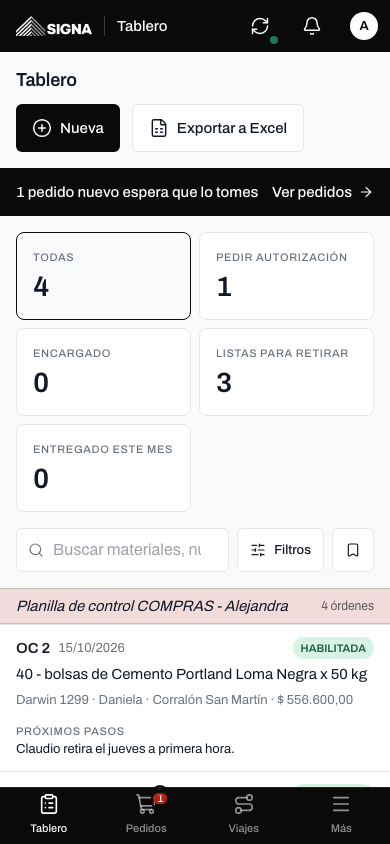
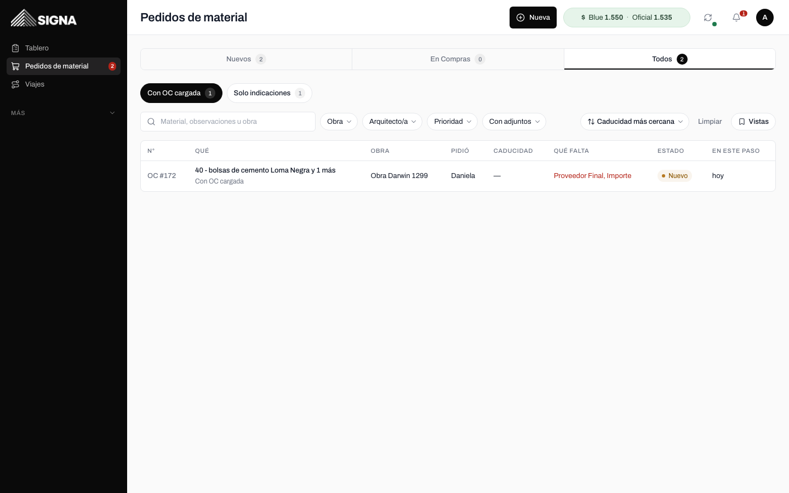
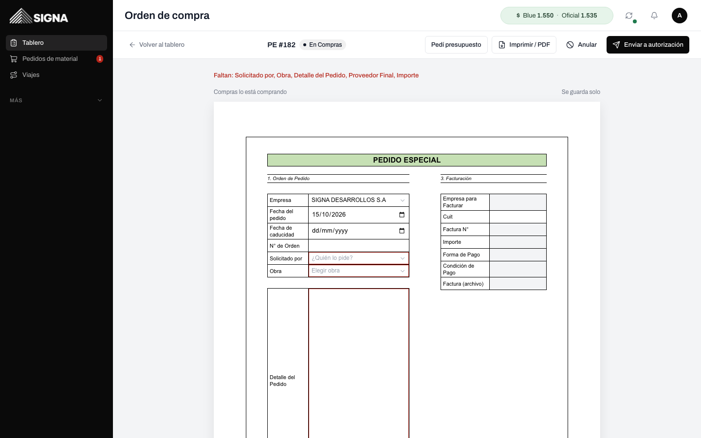
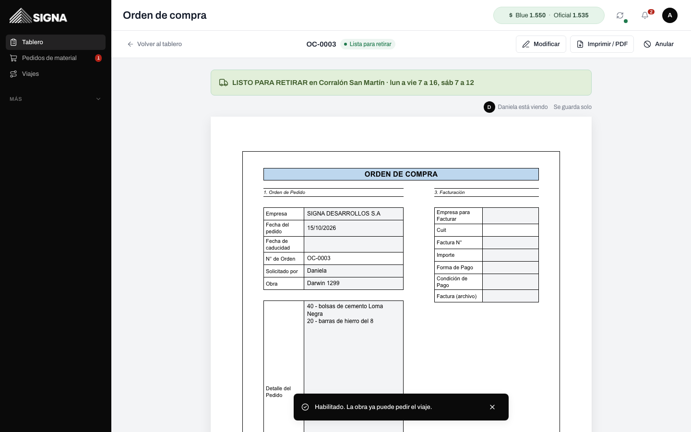
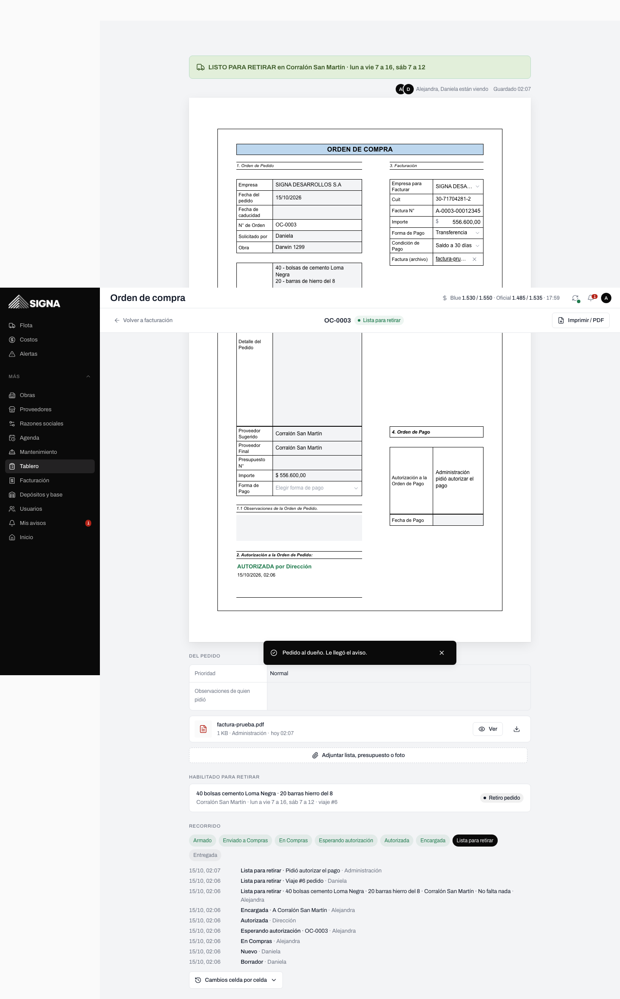

# Compras en Signa · Guía para Alejandra (y Camila)

Todo lo que hacías en tu planilla (OC NUEVA, PEDIDOS ESPECIALES y el TABLERO DE CONTROL) ahora está en el
sistema, con las mismas palabras y las mismas columnas. **El pedido de la obra y la orden de compra son la
misma hoja**: la arquitecta empieza tu plantilla, vos la terminás, el dueño la autoriza y Camila completa la
facturación. Todos ven la misma hoja, cada uno con sus celdas.

Entrás y caés directo en el **Tablero**. Abajo (o a la izquierda en la computadora): **Tablero · Pedidos ·
Viajes · Más** (en Más: Habilitados, Proveedores, Mis avisos, Cuenta).

## 1. El tablero (tu planilla de control)

Es tu "TABLERO DE CONTROL ORDENES DE C", con su franja rosa: una fila por orden, tus columnas en tu orden,
encabezado gris fijo, la Nº con el número de tu leyenda y los "A confirmar" en amarillo. Al final, la columna
**FACTURACIÓN** (lo que carga Camila).

- Arriba, si hay pedidos nuevos, la franja negra **"N pedidos nuevos esperan que los tomes → Ver pedidos"**.
- Cinco tarjetas: **Todas**, **Pedir autorización**, **Encargado**, **Listas para retirar** (con el camión) y
  **Entregado este mes**. Tocás una y el tablero muestra solo esas.
- **Estado**, **Próximos pasos** y **Comentarios** se editan en la celda, como en Excel. Un estado puesto a
  mano queda anotado "(ajustado a mano por Alejandra el 14/10)".
- **Tocás una fila y la orden se abre a página completa.** Arriba queda fija la barra con **← Volver al
  tablero**, el número, el estado y los botones. Volver te deja en el tablero con los mismos filtros, el
  mismo orden y en la misma altura de la lista.

En el celular, el tablero es una lista:

### Qué significa cada estado

| Estado | Cuándo |
|---|---|
| **Solicitud de presupuesto** | Marcaste "Pedí presupuesto" y todavía no la mandaste a autorizar. |
| **Pedir autorización** | La mandaste a autorización: la tiene el dueño. |
| **Autorizada** | El dueño la autorizó. |
| **Encargado** | Tocaste "Marcar como encargada": ya se la pediste al proveedor. |
| **Habilitada** | Habilitaste el retiro (o avisaste que la entrega el proveedor). Va con el camión. |
| **Entregado** | Llegó todo a la obra (y marcaste "con esto no falta nada"). |
| **Anulada** | La anulaste. |

Los **pedidos especiales** además tienen su semáforo: No se hizo nada todavía · En proceso · Lista · Anulada.

## 2. Los pedidos que llegan (Pedidos)

**Pedidos** es tu bandeja: lo que te mandaron las arquitectas y lo que estás comprando (**Nuevos · En Compras
· Todos**). Cada fila dice qué le falta ("Faltan: Proveedor Final, Importe").

- **Con OC cargada**: la arquitecta ya completó buena parte de la plantilla (proveedor sugerido, importe…).
- **Solo indicaciones**: mandó solo la obra y qué necesita ("Puerta placa 80 cm"); el resto lo completás vos.
- Cuando abrís uno nuevo, pasa solo a **En Compras** (así la arquitecta sabe que lo tomaste).
- Desde el pedido: **Enviar a autorización**, **Devolver con nota** (vuelve a la arquitecta con lo que falta)
  o **Anular**.

## 3. La plantilla (OC y PE)

Es tu bloque de la planilla, en una hoja A4: **ORDEN DE COMPRA** con la franja celeste o **PEDIDO ESPECIAL**
con la franja verde. Escribís directo en la celda y **se guarda sola** ("Guardado 17:59"; Ctrl+S también).

- **Nueva**, arriba del tablero: **Pedir materiales** (el rápido), **Armar orden de compra** o **Armar pedido
  especial**.
- Las celdas que no podés tocar están en gris. Las que faltan para el paso siguiente tienen borde rojo y arriba
  dice "Faltan: …". Para mandarla a autorización hacen falta Empresa, Solicitado por, Obra, Detalle del Pedido,
  Proveedor Final e Importe (o "A confirmar").
- Proveedor: se elige de la lista; si no está, **Nuevo proveedor** o **Agregar sucursal** se abren al costado.
- **Si otro está en la misma hoja** lo ves arriba ("Daniela está viendo") y lo que escribe aparece solo, con un
  destello. Si los dos cambian la misma celda, gana el primero y al otro le aparece "Alejandra cambió esto
  hace 10 s", sin pisarlo. Todo queda en **Cambios** (quién, cuándo, qué había antes).
- **Enviar a autorización** le pone el número (OC-0417 o PE-0151, cada uno con su numeración), arma el PDF y le
  avisa al dueño.
- Una orden autorizada se cambia con **Modificar**; si cambiás el Proveedor Final o el Importe, vuelve a
  autorización ("v2").

## 4. Encargar y habilitar el retiro

Autorizada, abajo queda fija la barra con **Marcar como encargada** y **Habilitar para retirar**. Al habilitar
elegís la sucursal, el horario, el contacto y qué se retira (puede ser una parte). La barra se pone verde:
**"LISTO PARA RETIRAR en Corralón San Martín · lun a vie 7 a 16"** (o "Entrega el proveedor el …"), y a la
arquitecta le llega el aviso con **Pedir el viaje**.

## 5. El PDF

**Imprimir / PDF** está siempre arriba. El PDF es la misma hoja, una página A4; cuando Camila adjunta la
factura, va como segunda página. Se guarda solo al mandarla a autorización y al autorizarla.

## 6. Facturación (Camila)

Camila entra con Administración y tiene **Tablero** y **Facturación** (Falta la factura · Falta el pago). Abre
la orden, completa **3. Facturación** (Empresa para Facturar, Cuit, Factura N°, Importe, Forma y Condición de
Pago), adjunta la factura y toca **Pedir autorización** del pago. El dueño lo autoriza en **Aprobaciones →
Pagos** y Camila pone la Fecha de Pago. Le llega un aviso cuando una orden se autoriza y cuando se marca Acopio.

## 7. Importar tu tablero de Excel

Por ahora lo hace el dueño (**Más → Compras → Importar Excel**). Opcional, para cargar tu historial:

1. Elegís el .xlsx. El sistema busca la hoja del tablero y la fila con "N° OC / PE" y "SOLICITADO POR".
2. Ves **todas** las filas: en rojo las que no se pueden importar (con el motivo), en amarillo las que
   conviene revisar (una fecha rara como "31/3/0202", un proveedor nuevo, una obra que no reconoció).
3. Corregís en la misma tabla (la obra, el estado, el número) o destildás las que no querés.
4. **Importar N filas válidas.**

- Entiende los errores de tipeo del estado (ENRTEGADO, ANUDALADA, ENCARGADAS…), los importes como "$
  723.839,42" y los "????" (quedan "A confirmar"), los números como "41 B", y los nombres sin tildes.
- Lo que no es un estado ("REPETIDA", "EN LA OFICINA") o una fecha de entrega que no es fecha ("jue/vier")
  pasa a Comentarios.
- Si importás dos veces el mismo archivo no se duplica: se actualizan las que ya estaban.
- Después de importar, la numeración sigue sola después del número más alto.

## 8. Exportar el tablero

**Exportar a Excel** (arriba a la derecha) baja un Excel como tu planilla: la franja de título, el
encabezado gris, tus mismas columnas en tu orden y con tus títulos, los colores de cada estado y los "A
CONFIRMAR" en amarillo, con los filtros que tengas puestos.

## 9. Filtros y vistas guardadas

En el Tablero, en Pedidos, en Viajes y en Habilitados tenés la misma barra, en una sola fila: un buscador,
chips que se combinan (Obra, Solicitado por, Proveedor, Estado, fechas…), el orden, **Limpiar** y **Vistas**.
Si no entran todos, los que sobran quedan en el botón **Filtros (N)**. En el celular están en el botón
**Filtros**.

- **Vistas → Guardar los filtros de ahora como vista:** le ponés un nombre ("Pendientes de retiro",
  "Pinares") y la tenés a un toque siempre.
- En **Pedidos**, la fecha de caducidad de hoy o vencida está en rojo y la de mañana en ámbar. En el filtro
  **Arquitecto/a** ves cuántos pidió cada uno.

## 10. Coordinar un viaje para las arquitectas

**Viajes → Coordinar viaje.** Primero "Para quién": la obra y el responsable. Después el formulario de
siempre. A la derecha, **Pedidos anteriores**: los viajes que coordinaste, para repetirlos. El pedido sale a nombre de esa persona y vos quedás como quien lo coordinó: los avisos del viaje
les llegan a las dos y el chofer ve "Pidió Daniela · coordinó …". Para un retiro en un proveedor elegís
"Retirar en un proveedor" y aparece lo que habilitaste para esa obra.

**Viajes → Solicitudes:** todos los viajes (pendientes, aceptados, en curso y lo entregado hoy) en una tabla,
con filtros de Obra, Lugar, Persona, Prioridad, Fecha, Estado y Chofer. Con el filtro de **Lugar**, quedan
agrupados con una fila gris ("Corralón San Martín · 3 retiros"); tocás un lugar o un nombre de la tabla y ves
esos (de una persona, también los viejos). En los pendientes podés **Editar** (fecha,
prioridad, qué) o **Cancelar** con el motivo: les avisamos al que pidió y a los choferes.

## 11. Numeración y "Solicitado por"

La numeración de OC y PE la fija el dueño en su Configuración (solo para arriba). Los nombres que piden sin
usuario (Romina, Hernán…) los agregás vos desde la misma orden: en **Solicitado por**, **+ otro nombre**.

## 12. El dólar

Arriba a la derecha, en la píldora verde: **$ Blue 1.550 · Oficial 1.535** (venta). Tocalo para ver compra, venta y la
hora. Las órdenes en dólares guardan la venta
del oficial del día.

## Lo que ve el dueño

En **Aprobaciones → Órdenes** ve cada orden con todos los datos escritos y el PDF, y la autoriza o la rechaza
con el motivo. Si rechaza, vuelve a **En Compras** con el motivo arriba de la hoja. En **Aprobaciones →
Pagos** autoriza los pagos que pidió Camila.

