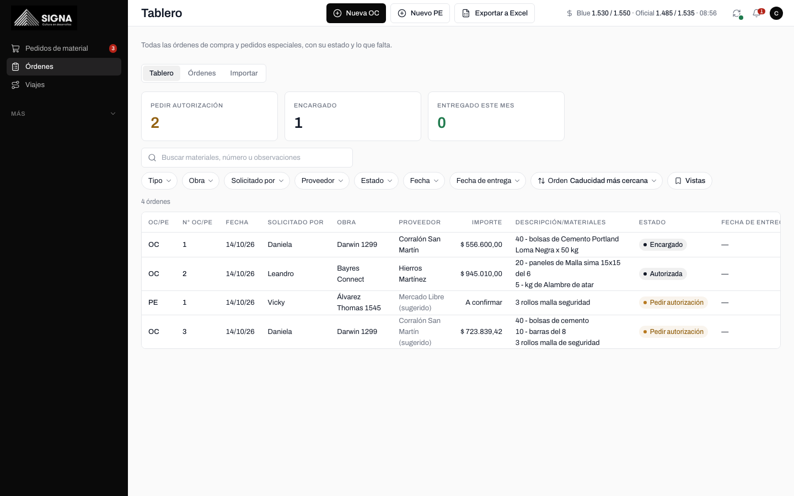
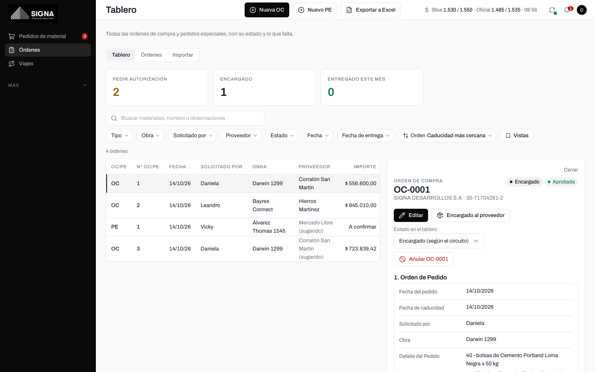
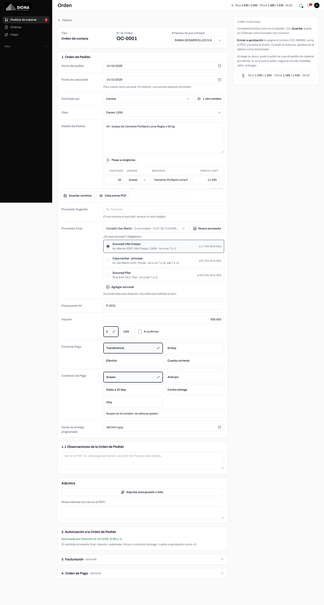
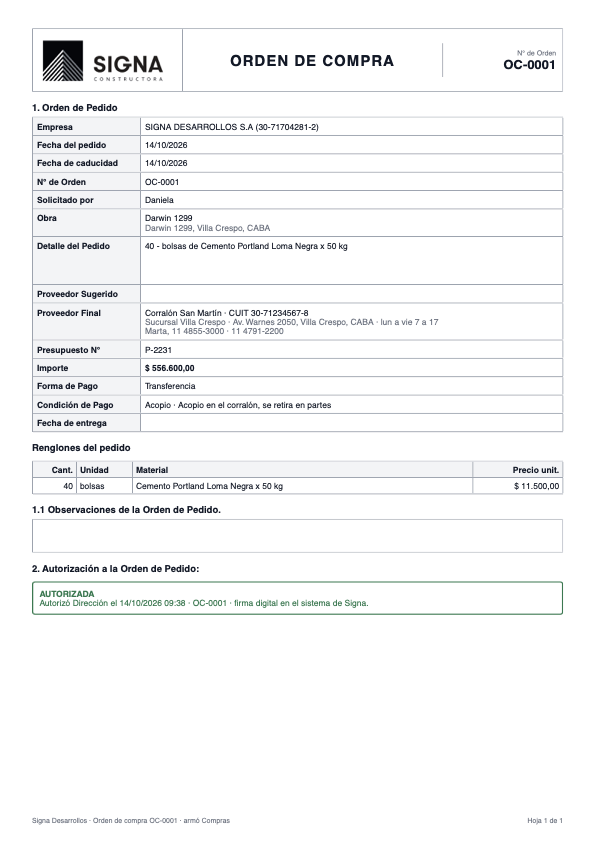
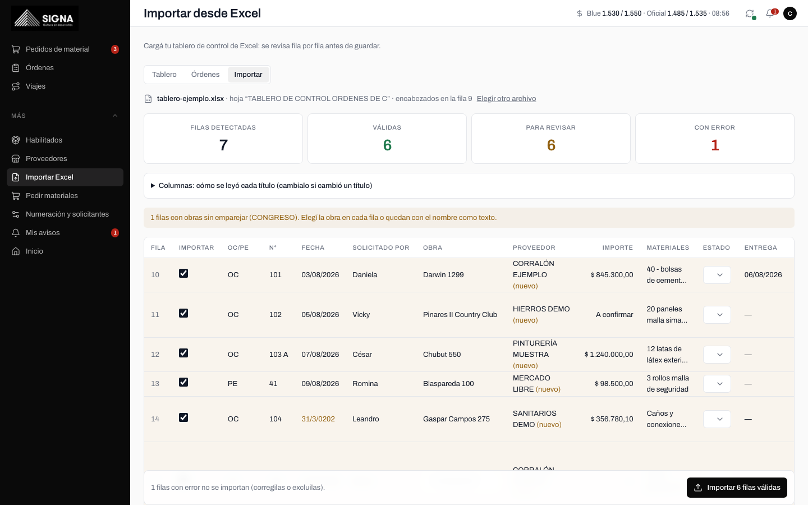
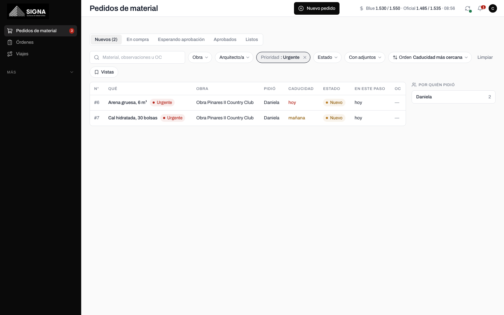
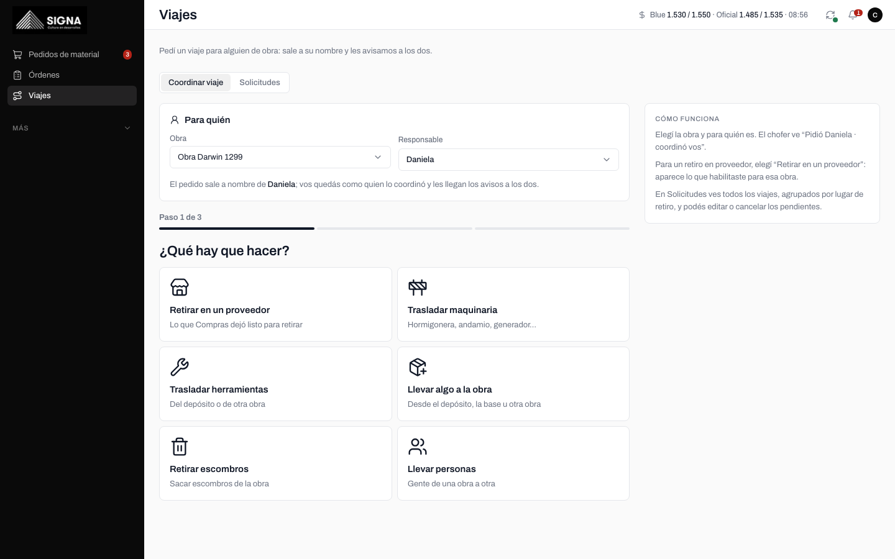
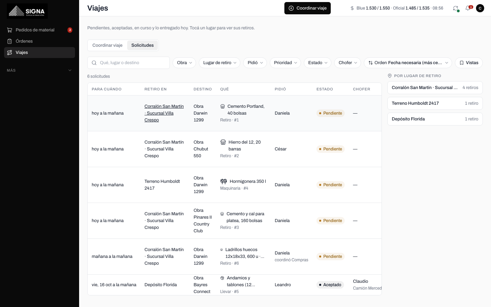
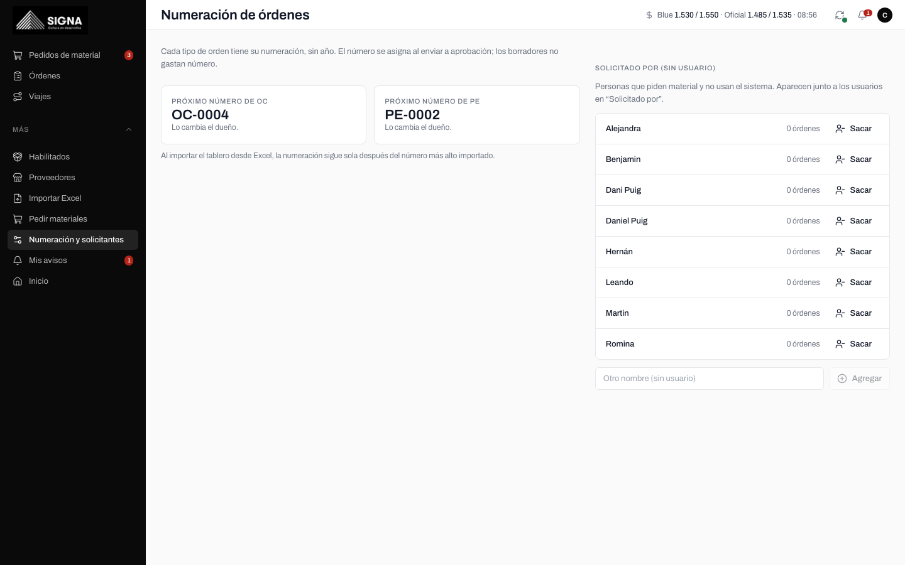
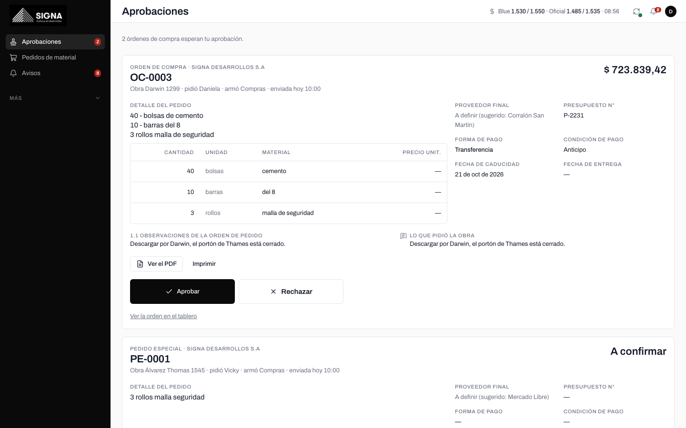

# Compras en Signa · Guía para Alejandra

Todo lo que hacías en tu planilla (OC NUEVA, PEDIDOS ESPECIALES y el TABLERO DE CONTROL) ahora está
en el sistema, con las mismas palabras y las mismas columnas, pero sin copiar y pegar. Entrás con tu
usuario de Compras y abajo (o a la izquierda en la computadora) tenés **Pedidos · Órdenes · Viajes · Más**.

## 1. El tablero (tu planilla de control)

**Órdenes → Tablero.** Es tu "TABLERO DE CONTROL ORDENES DE C": una fila por orden, con tus columnas en
tu orden: OC/PE · N° OC/PE · Fecha · Solicitado por · Obra · Proveedor · Importe · Descripción/Materiales
· Estado · Fecha de entrega · Observaciones en OC / Próximos pasos · Comentarios.

- Arriba, tres números: **Pedir autorización**, **Encargado** y **Entregado este mes**. Tocás uno y el
  tablero muestra solo esas.
- **Próximos pasos** y **Comentarios** se escriben en la misma tabla: tocás la celda, escribís y Enter
  (Shift+Enter para otra línea). Queda guardado con tu nombre y la hora.
- Tocás una fila y se abre la orden completa a la derecha (en el celular, abajo), con las secciones 1 a 4,
  sin cambiar de pantalla.
- Por defecto arriba van las que vencen antes (Fecha de caducidad más cercana) y al final las
  entregadas y anuladas. Las vencidas dicen "venció 22/09" en rojo.

### Qué significa cada estado

| Estado | Cuándo |
|---|---|
| **Solicitud de presupuesto** | Marcaste "Pedí presupuesto" en el pedido y todavía no armaste la OC. |
| **Pedir autorización** | La mandaste a aprobación: la tiene el dueño. |
| **Autorizada** | El dueño la aprobó. |
| **Encargado** | Ya se la pediste al proveedor ("Encargado al proveedor") o habilitaste algo para retirar. |
| **Entregado** | Llegó todo a la obra (y marcaste "con esto no falta nada"). |
| **Anulada** | La anulaste o el dueño la rechazó. |

El estado cambia solo con lo que va pasando. Si necesitás, lo cambiás a mano en la orden ("Estado en el
tablero"): queda así hasta que pase algo nuevo (por ejemplo, que llegue a la obra).

Los **pedidos especiales** además tienen su semáforo, como arriba de cada PE en tu planilla: No se hizo
nada todavía · En proceso (falta entregar o pagar) · Lista (paga y entregada) · Anulada.

## 2. Crear una OC o un PE (la plantilla)

**Órdenes → Nueva OC** (o **Nuevo PE**). También desde un pedido de material: **Armar orden de compra**.
Es tu bloque de la planilla, con las mismas etiquetas y en el mismo orden:

- **Encabezado:** OC o PE, el N° de Orden ("se asigna al enviar") y la Empresa que compra (sale la de la
  obra, o Signa Desarrollos).
- **1. Orden de Pedido:** Fecha del pedido, Fecha de caducidad (una semana después, como tu fórmula),
  Solicitado por (si no está en la lista, "+ otro nombre"), Obra, **Detalle del Pedido** (escribilo como
  siempre, una línea por material: "40 - bolsas de cemento"), Proveedor Sugerido, Proveedor Final,
  Presupuesto N°, Importe (o "A confirmar", tus "????"), Forma de Pago, Condición de Pago y Fecha de
  entrega programada.
  - **Pasar a renglones** convierte cada línea del detalle en un renglón con cantidad y unidad. Es
    opcional: con el detalle alcanza.
  - El Proveedor Final se puede dejar para después (hace falta para habilitar el retiro).
- **1.1 Observaciones de la Orden de Pedido:** van en el PDF.
- **Adjuntos:** el presupuesto del proveedor o la lista de materiales. Las notas internas no van en el PDF.
- **3. Facturación** y **4. Orden de Pago:** están plegadas; las completás cuando llega la factura o se
  paga. La autorización de la orden de pago la da el dueño con un botón.

Los botones de abajo:

- **Guardar:** queda en **Órdenes** como borrador, sin número. La retomás cuando quieras.
- **Vista previa PDF:** el PDF con la marca BORRADOR.
- **Enviar a aprobación:** le pone el número (OC-0417, o PE-0151: cada uno con su numeración), arma el PDF
  y le avisa al dueño con todos los datos escritos.

Si la orden no venía de un pedido (la armás vos directo), el sistema crea el pedido de material a nombre
de quien elegiste en "Solicitado por": así sigue el circuito (habilitar, retiro, entrega).

**Editar una orden ya autorizada:** la abrís y tocás **Editar**. Si cambiás el Proveedor Final, el
Importe, los materiales, la Forma o la Condición de Pago, vuelve a aprobación con el mismo número y "v2".
Si solo completás Facturación, Orden de Pago, Próximos pasos, Comentarios u Observaciones, no.

## 3. El PDF

Sale de los datos de la orden, con el diseño de tu bloque: el logo, ORDEN DE COMPRA o PEDIDO ESPECIAL,
la grilla con tus etiquetas, 1.1 Observaciones, 2. Autorización (con el sello cuando el dueño la aprueba)
y Facturación y Orden de Pago solo si tienen datos.

## 4. Órdenes (lo que antes era bajar en la hoja)

**Órdenes → Órdenes:** todas las OC y PE, con los borradores arriba y un buscador por número, proveedor,
obra o material. Cada una se abre en la plantilla.

## 5. Importar tu tablero de Excel

**Órdenes → Importar.** Opcional, para cargar tu historial cuando quieras:

1. Elegís el .xlsx. El sistema busca la hoja del tablero y la fila con "N° OC / PE" y "SOLICITADO POR".
2. Ves **todas** las filas: en rojo las que no se pueden importar (con el motivo), en amarillo las que
   conviene revisar (una fecha rara como "31/3/0202", un proveedor nuevo, una obra que no reconoció).
3. Corregís en la misma tabla (la obra, el estado, el número) o destildás las que no querés.
4. **Importar N filas válidas.**

- Entiende los errores de tipeo del estado (ENRTEGADO, ANUDALADA, ENCARGADAS…), los importes como "$
  723.839,42" y los "????" (quedan "A confirmar"), los números como "41 B", y los nombres sin tildes.
- Lo que no es un estado ("REPETIDA", "EN LA OFICINA") o una fecha de entrega que no es fecha ("jue/vier")
  pasa a Comentarios.
- Si importás dos veces el mismo archivo no se duplica: se actualizan las que ya estaban.
- Después de importar, la numeración sigue sola después del número más alto.

## 6. Exportar el tablero

**Exportar a Excel** (arriba del tablero) baja un Excel con tus mismas columnas, en tu orden y con tus
títulos, con los filtros que tengas puestos.

## 7. Filtros y vistas guardadas

En el tablero, en Pedidos, en Órdenes y en Viajes tenés la misma barra: chips que se combinan (Obra,
Solicitado por, Proveedor, Estado, fechas…), un buscador y el orden. En el celular están en el botón
**Filtros**.

- **Vistas → Guardar los filtros de ahora como vista:** le ponés un nombre ("Pendientes de retiro",
  "Pinares") y la tenés a un toque siempre.
- En **Pedidos**, la fecha de caducidad de hoy o vencida está en rojo y la de mañana en ámbar. A la derecha,
  cuántos pidió cada uno: tocás un nombre y ves solo los suyos.

## 8. Coordinar un viaje para las arquitectas

**Viajes → Coordinar viaje.** Primero "Para quién": la obra y el responsable. Después el formulario de
siempre. El pedido sale a nombre de esa persona y vos quedás como quien lo coordinó: los avisos del viaje
les llegan a las dos y el chofer ve "Pidió Daniela · coordinó …". Para un retiro en un proveedor elegís
"Retirar en un proveedor" y aparece lo que habilitaste para esa obra.

**Viajes → Solicitudes:** todos los viajes (pendientes, aceptados, en curso y lo entregado hoy), agrupados
por lugar de retiro ("Corralón San Martín · 3 retiros"). Tocás un lugar y ves esos; tocás un nombre y ves
todos los viajes que pidió esa persona, incluidos los viejos. En los pendientes podés **Editar** (fecha,
prioridad, qué) o **Cancelar** con el motivo: les avisamos al que pidió y a los choferes.

## 9. Numeración y "Solicitado por"

**Más → Numeración y solicitantes:** ves el próximo número de OC y de PE (los cambia solo el dueño, y solo
para arriba) y la lista de nombres que piden sin usuario (Romina, Hernán…), con alta y baja.

## 10. El dólar

Arriba a la derecha (en el celular, en el inicio): **Blue compra / venta · Oficial compra / venta · hora**.
Tocalo para ver la hora de la última actualización y la fuente. Las órdenes en dólares guardan la venta
del oficial del día.

## Lo que ve el dueño

En **Aprobaciones** ve cada orden con todos los datos escritos (detalle, proveedor, importe, forma y
condición de pago, observaciones, adjuntos y el PDF) y la aprueba o la rechaza con el motivo. Si
rechaza, el pedido vuelve a "En compra" y la corregís con número nuevo.

